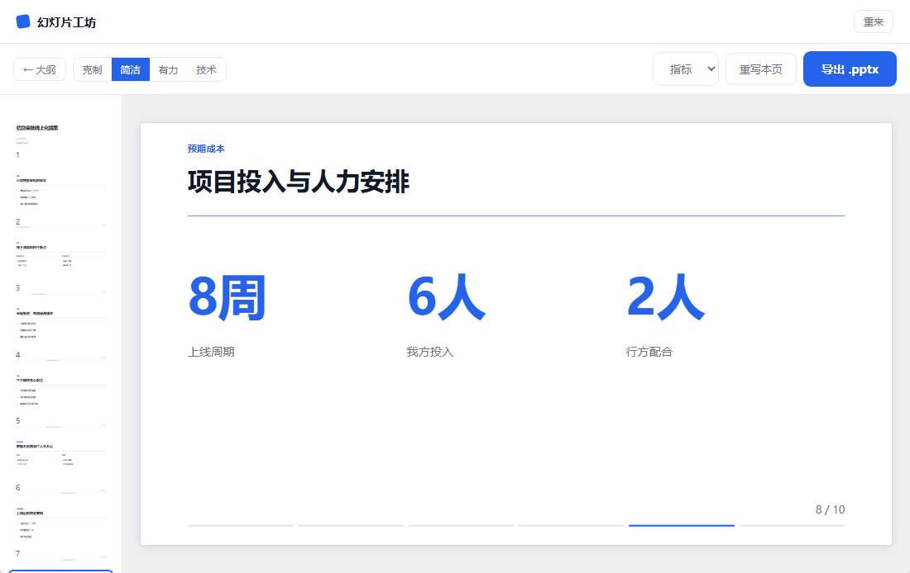

# 幻灯片工坊（Slide Studio）

把一句话变成一份**能下载、能继续编辑的 .pptx** 的 Anna App。

先出大纲，你确认了再写正文。全程两次模型调用，导出的是真正的 PowerPoint 文件，
不是图片，也不是 PDF。



## 用法

1. 写一句话需求，可选填听众、页数、结构与风格
2. 检查并修改生成的大纲 —— 这一步不消耗模型额度
3. 生成正文，在 16:9 画布上直接改字、换主题、换版式
4. 导出 `.pptx`，PowerPoint 和 WPS 都能继续编辑

## 快速开始

需要 Node 22+ 和 [uv](https://docs.astral.sh/uv/)。

```powershell
npm install

# 本地运行（mock 模型：不消耗额度，也不需要账号）
.\dev.cmd dev --slug slide-studio --mock-llm fixtures\replies.jsonl
# 打开 http://localhost:5180/

# 校验 manifest 与 bundle
.\dev.cmd validate --strict
```

接真实模型：先 `anna-app login --host <nexus>` 登录一次，然后去掉 `--mock-llm` 参数即可。

`dev.cmd` 会把 `UV_CACHE_DIR` 锁到项目内 `.uv-cache/`，不污染全局缓存。

## 目录结构

```
manifest.json        App 声明（schema 4，不含 Executa）
app.json             商店信息
bundle/
  index.html         入口（CSP 下无内联脚本）
  css/theme.css      全部样式；配色由 JS 注入 CSS 变量
  js/
    deck.js          数据契约：几何、主题、7 种版式、规范化与校验
    ai.js            提示词、模型调用、宽松 JSON 解析
    render.js        画布与缩略图渲染、就地编辑
    export.js        pptx 生成与上传保存
    quota.js         额度读取与展示
    app.js           状态机与界面编排
  vendor/
    pptxgen.bundle.js
fixtures/            本地 mock 应答
tools/               mock 数据生成、CDP 截图与探测脚本
docs/                技术方案、产品设计、实现笔记、平台调研
```

没有构建工具：原生 ES Module 直接运行。产物本来就是静态文件，多一层构建只多一处失败点。

## 文档

- [技术方案](docs/design.md) —— 架构、数据契约、容错策略、导出链路
- [产品设计](docs/product-design.md) —— 定位、场景、界面规格、版式与主题
- [实现笔记](docs/implementation-notes.md) —— 实测数据、设计取舍、已知问题
- [平台调研](docs/anna-app-brief.md) —— Anna 的平台规则、发布流程与额度经济学

## 交付信息

- 平台：<https://staging.anna.partners>
- 标识：`@crazyseal/slide-studio`
- 分类：productivity
- 截图：`docs/screenshots/`
